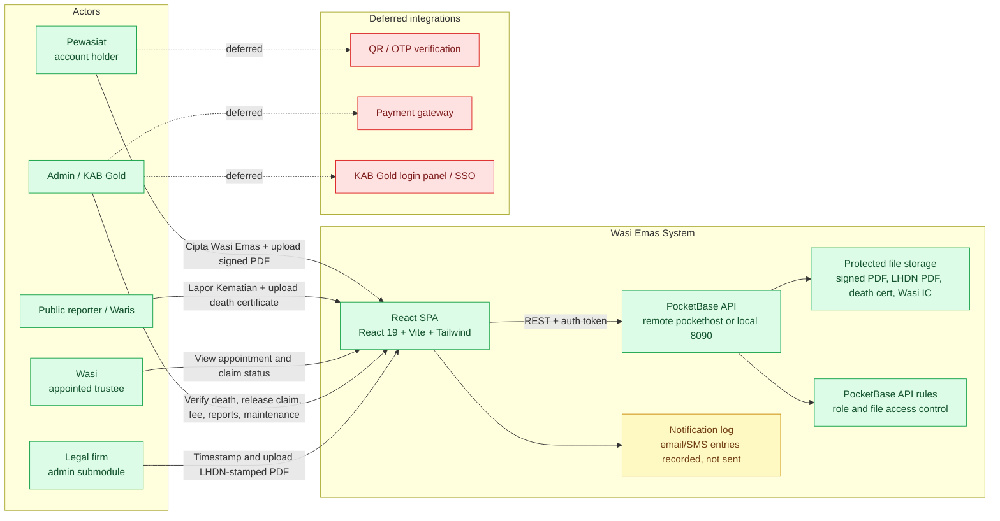
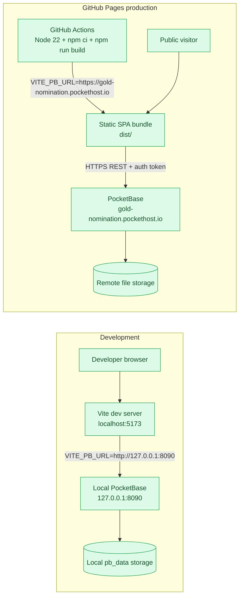

# System Context and Deployment

## System Context (C4-inspired)

### What to notice

- The SPA talks directly to PocketBase. There is no custom backend service.
- The legal firm is not a separate role. It is the same admin role using the legal-verification page.
- Email/SMS is represented by `emailService`, which writes notification entries and updates `notification_log`; it does not call a real provider.
- LHDN stamping is a manual file step. The app only records the timestamp/status and stores the uploaded final document.
- The deferred integrations are shown with dashed arrows so they are not confused with implemented flows.

## Deployment

### Deployment notes

- `frontend/src/lib/pocketbase.ts` defaults to the remote pockethost URL.
- `.env.local` can override the URL for local development.
- The GitHub Pages workflow sets `VITE_PB_URL` explicitly during the build.
- Remote and local PocketBase schemas are kept in sync through migrations and the remote schema setup script.
- Protected files are not public URLs. The frontend calls `pb.files.getToken()` and appends the token when opening a protected file.
