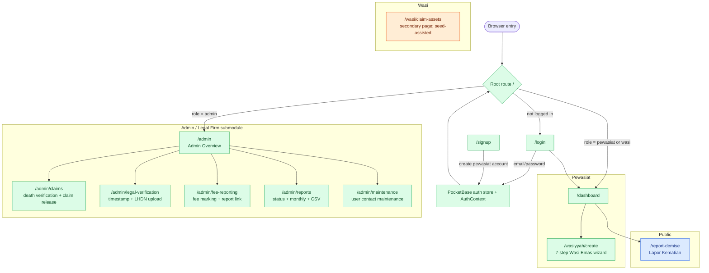
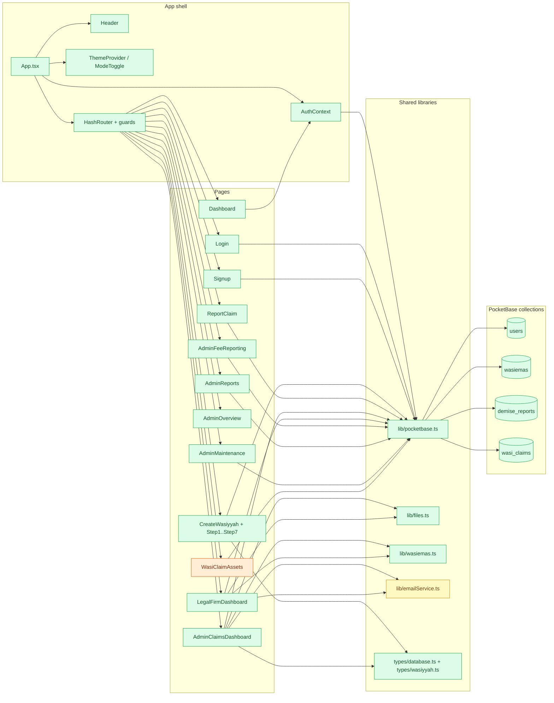

# Navigation and Components

## Full Route and Role Map

### Route notes

- `ProtectedRoute` only checks that a user is authenticated and redirects admins to `/admin`.
- `AdminRoute` requires `role = admin`.
- There is no separate `legal` role. The legal-firm page is under `/admin`.
- `/wasi/claim-assets` exists but is not the source of the seeded claim. It is limited because `demise_reports` is admin-only in the current API rules.
- The public report form does not require login.

## Frontend Component Map

### Component notes

- `lib/wasiemas.ts` parses `wasiyyah_data`, extracts wasi/waris, and matches a death report to a Wasi Emas by NRIC.
- `lib/files.ts` obtains a PocketBase file token before opening protected files.
- `lib/emailService.ts` writes notification entries and logs them; it is the simulated email/SMS boundary.
- `AdminClaimsDashboard` and `LegalFirmDashboard` both parse the embedded `wasiyyah_data` JSON rather than querying separate wasi/waris tables.
- `WasiClaimAssets` is a secondary/seed-assisted page, not the current source of the seeded claim.
