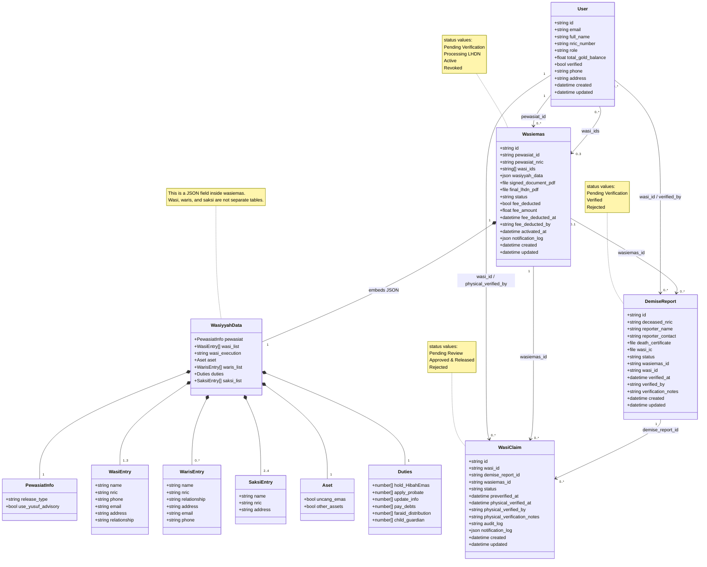
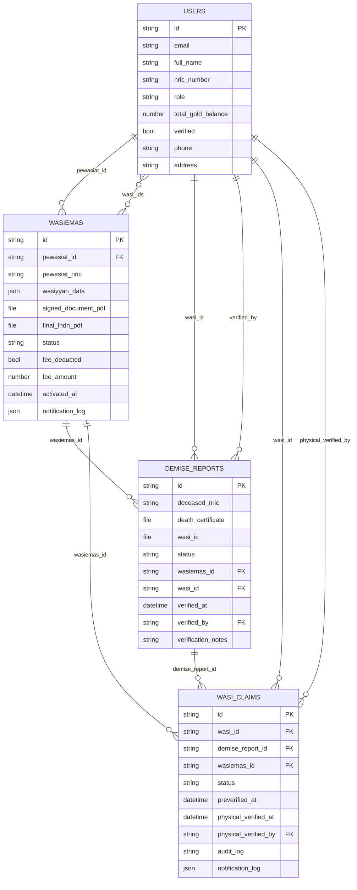

# Data Model

## UML Class Diagram

### Model notes

- `wasiyyah_data` is stored as a JSON object inside `wasiemas`. It is not a relational table.
- `wasi_ids` is a multi-relation to `users`, but the full wasi details remain in the JSON.
- `demise_reports.wasiemas_id` and `wasi_id` are stored as relations after the admin verifies and matches the report.
- `notification_log` is a JSON array of `{ channel, recipient, subject, sent_at }` entries. It is a record of simulated notification activity, not proof that an email/SMS was delivered.
- `audit_log` is plain text appended by the release action.

## ERD

### ERD notes

- `WASIEMAS.wasiyyah_data` contains the embedded `wasi_list`, `waris_list`, and `saksi_list`. It is intentionally not normalised into separate relational tables.
- The same `users` collection is used for Pewasiat, Wasi, and Admin accounts.
- A `Wasiemas` record can have up to three Wasi users in `wasi_ids`, but the Wasi details used for PDF generation and notifications are read from the JSON.
- `demise_reports` can exist without a matched Wasi Emas until the admin verifies it. The current UI matches by `deceased_nric` against `wasiemas.pewasiat_nric`.
- `wasi_claims` is the claim/release record. Physical verification is represented by fields, not by a separate verification table.
