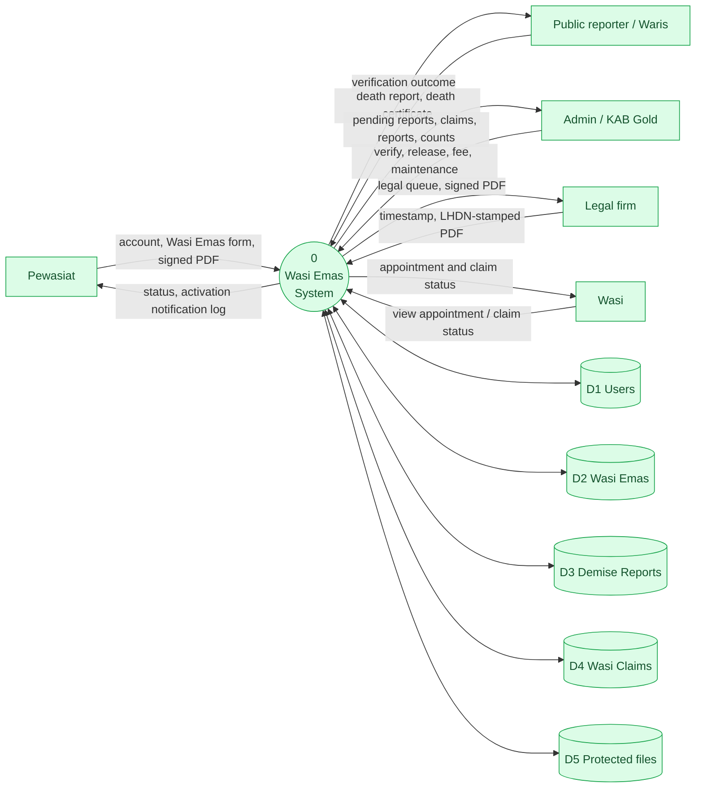
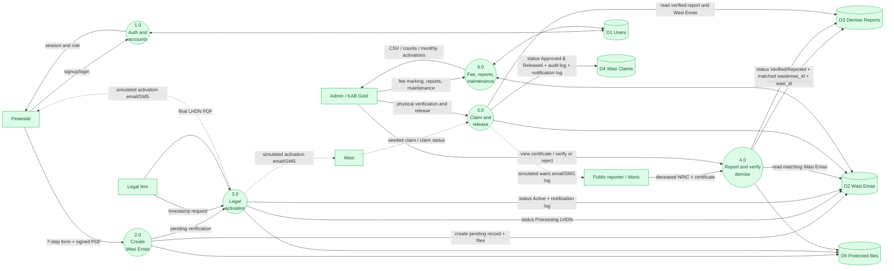

# Data Flow Diagrams

These are Mermaid approximations of a structured-analysis DFD for readers who need that view alongside UML.

## DFD Level 0 — Context

## DFD Level 1 — Processes and Stores

### DFD notes

- Dashed arrows represent simulated or seed-assisted data movement.
- `P5` receives a seeded claim in the current demo. Wasi self-service claim creation is not an end-to-end path.
- `P3` is a manual/out-of-system LHDN process; the app only stores the final PDF and status.
- `P6` writes/reads fee and reporting data but does not move gold or connect to KAB Gold.
