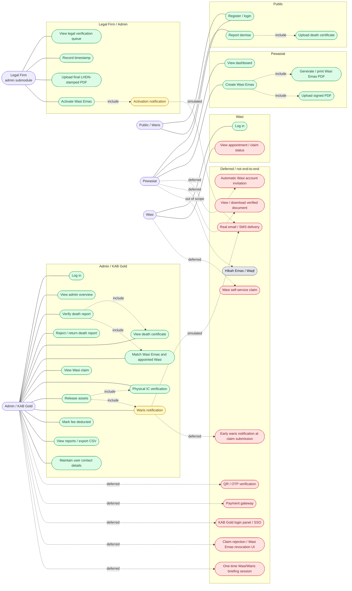

# Use Cases

This is a Mermaid use-case map, not strict UML use-case notation. Actors are on the left/right, use cases are stadium shapes, and dashed arrows show includes or deferred relationships.

## Full Use-Case Map

## Use-Case Rules

- `U12 Verify death report` includes viewing the certificate and matching the Wasi Emas.
- `U18 Release assets` includes physical IC verification and waris notification.
- `U19 Waris notification` and `U27 Activation notification` are simulated as notification-log entries.
- `U9 View appointment / claim status` is only partially possible; there is no dedicated Wasi appointment page and the claim page is limited by current rules.
- `D1 Wasi self-service claim` is the main missing user path. The demo claim is seeded.
- `D11 Hibah Emas / Waqf` is out of scope for the current product.
