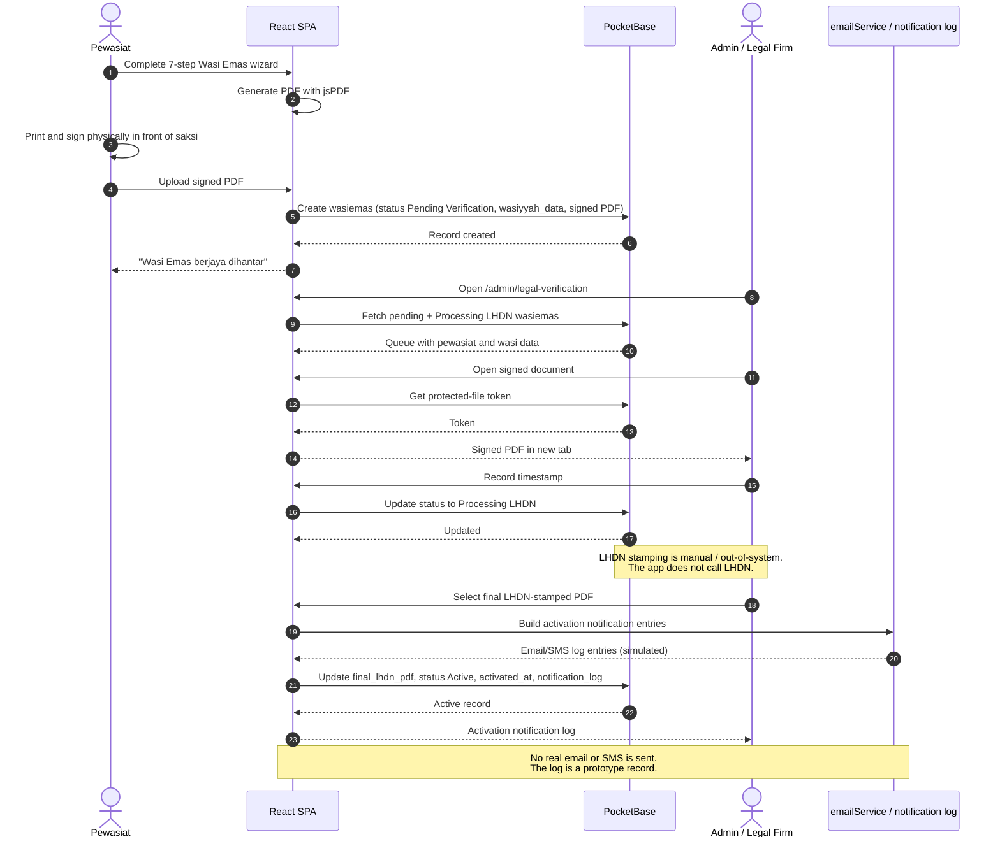
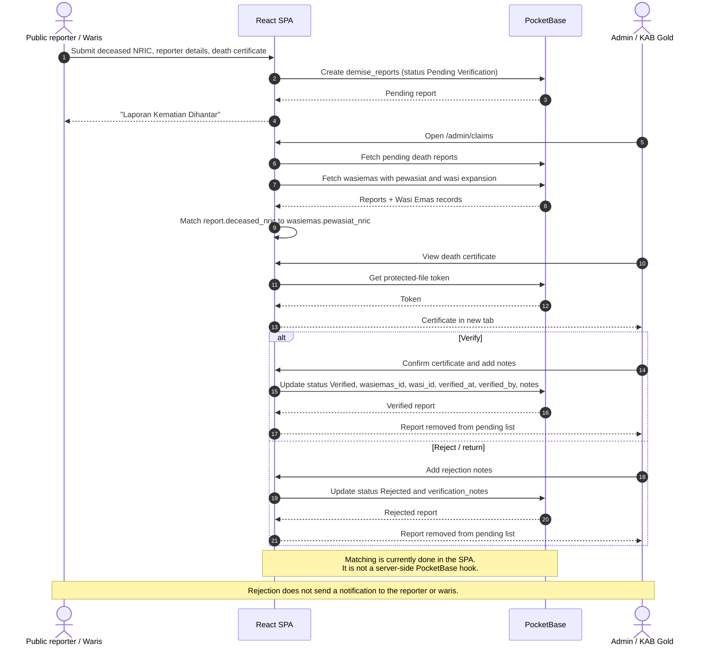
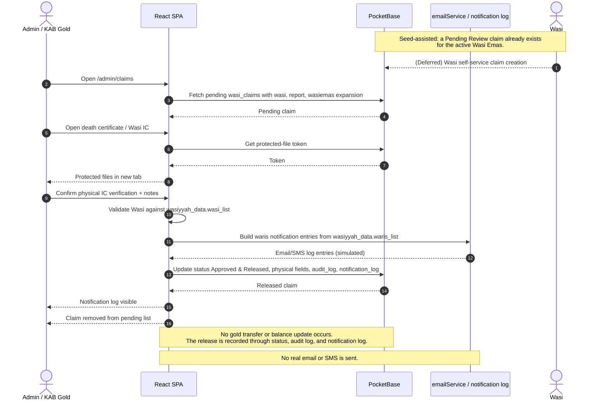

# Sequence Diagrams

## 1. Legal Firm Activation

This is the path from a signed Wasi Emas PDF to an `Active` record.

### Status coverage

- `Pending Verification -> Processing LHDN`: implemented.
- `Processing LHDN -> Active`: implemented.
- `Active -> Revoked`: schema only; no UI action. Deferred.
- Activation email/SMS: simulated by notification-log entries.

## 2. Death Report Verification and Wasi Emas Matching

### Status coverage

- `Pending Verification -> Verified`: implemented.
- `Pending Verification -> Rejected`: implemented.
- No transition back from `Verified` or `Rejected` in the current UI.
- The matched Wasi Emas can still be `Pending Verification` at this stage. The claim/release flow requires a separate active Wasi Emas.

## 3. Wasi Claim and Asset Release

The current demo claim is **seeded**. The Wasi self-service claim path is deferred.

### Status coverage

- `Pending Review -> Approved & Released`: implemented.
- `Pending Review -> Rejected`: schema only; no UI action. Deferred.
- `preverified_at`, `physical_verified_at`, and `physical_verified_by` are fields, not separate statuses.
- The Wasi appointment check is done by comparing the claim's Wasi NRIC/email to `wasiyyah_data.wasi_list`.
- The Wasi Emas status is not changed by release.
