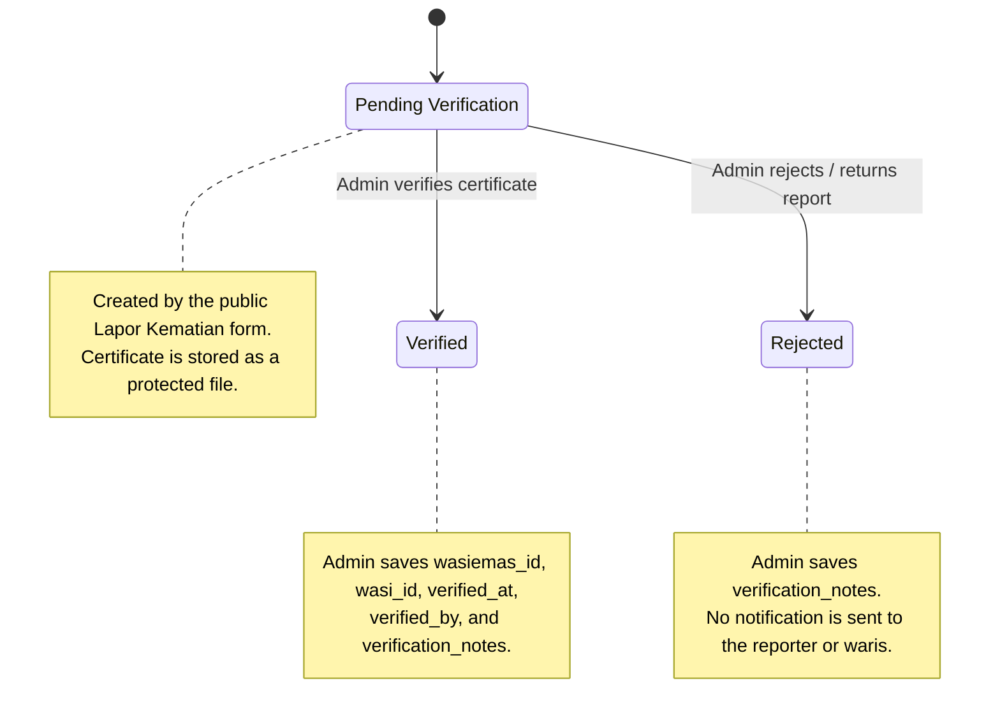

# State Machines

There are three main status models. They are separate, so do not read `Active` on a Wasi Emas as equivalent to `Approved & Released` on a claim.

## Wasi Emas Status

```mermaid
stateDiagram-v2
  [*] --> PendingVerification
  state "Pending Verification" as PendingVerification
  state "Processing LHDN" as ProcessingLHDN
  state "Active" as Active
  state "Revoked" as Revoked

  PendingVerification --> ProcessingLHDN: Admin records timestamp
  ProcessingLHDN --> Active: Admin uploads final LHDN PDF
  Active --> Revoked: Defined only; no UI action (deferred)

  note right of PendingVerification
    Created when Pewasiat uploads the signed PDF.
    Legal verification queue shows this record.
  end note

  note right of ProcessingLHDN
    LHDN stamping is manual / out-of-system.
    The app only stores the status and later the final PDF.
  end note

  note right of Active
    Activation notification log is written to wasiemas.notification_log.
    Actual email/SMS delivery is simulated.
  end note

  note right of Revoked
    Present in the status enum, but no current UI action triggers it.
    Treat as deferred.
  end note
```

### Trigger summary

| Transition | Trigger | Implemented? |
|---|---|---|
| `[*] -> Pending Verification` | Pewasiat uploads signed PDF | Yes |
| `Pending Verification -> Processing LHDN` | Admin clicks "Rekod Cap Masa" | Yes |
| `Processing LHDN -> Active` | Admin uploads final LHDN PDF | Yes |
| `Active -> Revoked` | No UI action | Deferred |

## Demise Report Status

### Trigger summary

| Transition | Trigger | Implemented? |
|---|---|---|
| `[*] -> Pending Verification` | Public report submission | Yes |
| `Pending Verification -> Verified` | Admin clicks "Sahkan" and confirms notes | Yes |
| `Pending Verification -> Rejected` | Admin clicks "Tolak" and enters a reason | Yes |
| `Verified -> ...` | No reopen/transition UI | Not defined |

## Wasi Claim Status

```mermaid
stateDiagram-v2
  [*] --> PendingReview
  state "Pending Review" as PendingReview
  state "Approved & Released" as ApprovedReleased
  state "Rejected" as Rejected

  PendingReview --> ApprovedReleased: Admin verifies physical IC and releases
  PendingReview --> Rejected: Defined only; no UI action (deferred)

  note right of PendingReview
    The demo claim is seeded.
    Wasi self-service claim creation is deferred.
  end note

  note right of ApprovedReleased
    physical_verified_at, physical_verified_by,
    physical_verification_notes, audit_log, and
    notification_log are written.
  end note

  note right of Rejected
    Present in the status enum, but no current UI action triggers it.
    Treat as deferred.
  end note
```

### Trigger summary

| Transition | Trigger | Implemented? |
|---|---|---|
| `[*] -> Pending Review` | Seeded claim; Wasi self-service creation deferred | Seed-assisted |
| `Pending Review -> Approved & Released` | Admin confirms physical verification and release | Yes |
| `Pending Review -> Rejected` | No UI action | Deferred |

## Important Distinction

`preverified_at`, `physical_verified_at`, and `physical_verified_by` are fields on a claim, not statuses. The claim remains `Pending Review` until the admin releases it. Do not draw a `Pre-Verified` state unless a future implementation adds it to the status enum and UI.
