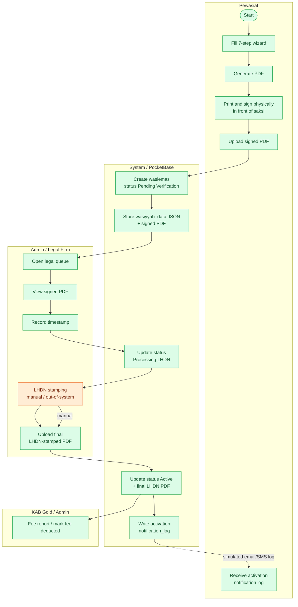
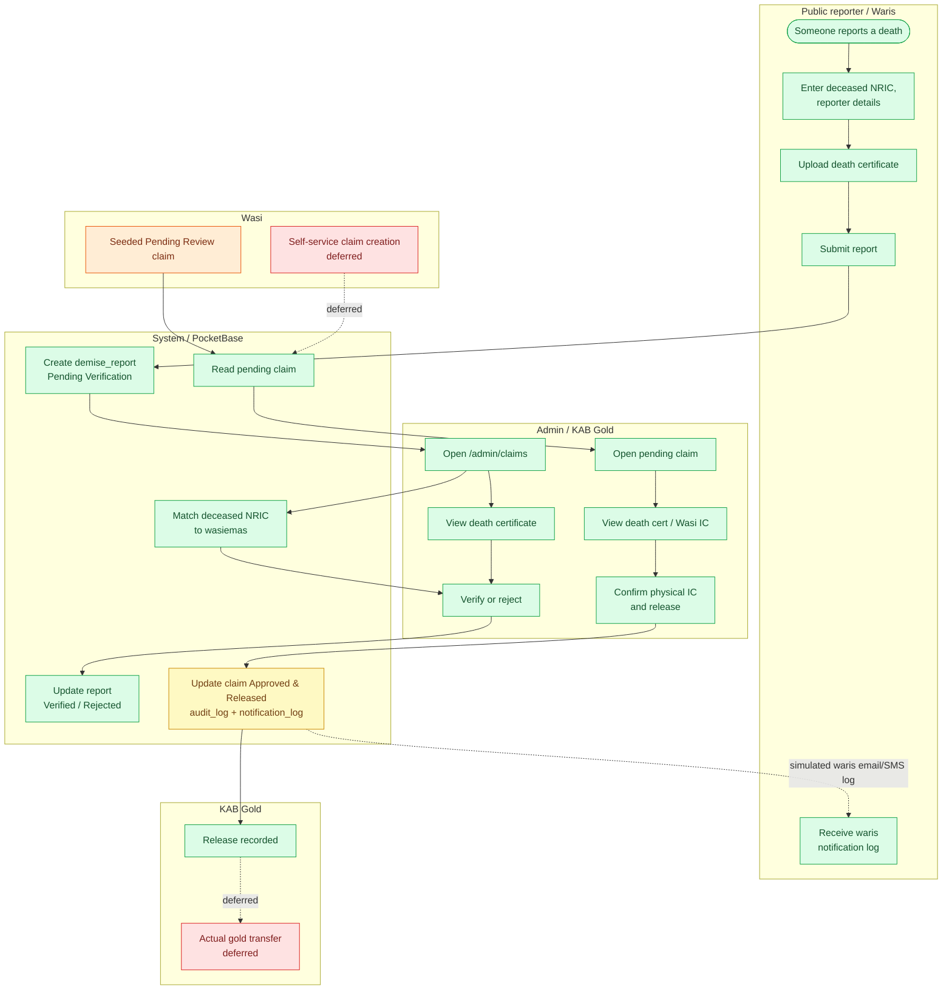

# Activity / Swimlane Flows

These are Mermaid flowchart approximations of BPMN-style swimlanes. They are intended to show who does what, not strict BPMN notation.

## 1. Wasi Emas Lifecycle — Pewasiat to Legal Activation to Fee

### What is real here

- The wizard, PDF generation, signed-PDF upload, legal timestamp, final LHDN upload, status transition, and notification log are implemented.
- LHDN stamping is manual.
- The activation email/SMS is a simulation recorded in `notification_log`.
- The legal firm is an admin submodule, not a separate role.
- Fee is a report/mark action, not a gold deduction.

## 2. Death Claim Lifecycle — Public Report to Release

### What is real here

- Public reporting, certificate viewing, admin verification/rejection, matching, physical verification recording, release status, audit log, and waris notification log are implemented.
- The pending claim is seeded. The Wasi does not create it through the current UI.
- Physical IC verification is a recorded admin action, not a scanner/reader integration.
- "Release" records the decision; it does not move gold or update balances.
- Waris notification is a simulated email/SMS log.
- Early waris notification at claim submission is not implemented.
- Claim rejection and Wasi Emas revocation are schema-only/deferred.
