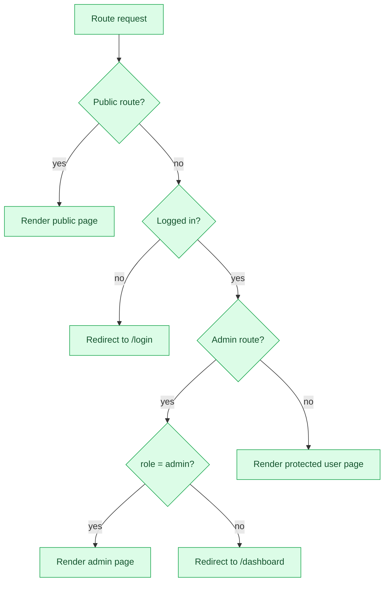

# Permissions and Access Control

## Role Model

The application uses three app roles in the `users` collection:

| Role | Meaning |
|---|---|
| `pewasiat` | KAB Gold account holder who creates Wasi Emas. |
| `wasi` | Appointed trustee who can view the appointment and claim status. |
| `admin` | KAB Gold/admin operator. Also acts as the legal-firm submodule. |

There is no separate `legal` role and no KAB Gold role in the current app. The admin role covers both for the prototype.

The PocketBase **superuser** is separate from the app `admin` role. The superuser is only for the PocketBase dashboard/schema/seed scripts.

## Permission Matrix

| Collection | Anonymous | Pewasiat | Wasi | Admin |
|---|---|---|---|---|
| `users` — list/view | No | Own record only | Own record only | All records |
| `users` — create | Yes, but forced `role = pewasiat` and `total_gold_balance = 0` | Yes, via signup | No | No via app rule; superuser only |
| `users` — update | No | No | No | Yes |
| `users` — delete | No | No | No | Yes |
| `wasiemas` — list/view | No | Own records | Records where `wasi_ids` includes the Wasi | All records |
| `wasiemas` — create | No | Yes, with own `pewasiat_id`, status forced to `Pending Verification` | No | No (superuser seed only) |
| `wasiemas` — update | No | No | No | Yes |
| `wasiemas` — delete | No | No | No | Yes |
| `demise_reports` — create | Yes, status forced to `Pending Verification` | Yes | Yes | Yes |
| `demise_reports` — list/view | No | No | No | Yes |
| `demise_reports` — update/delete | No | No | No | Yes |
| `wasi_claims` — list/view | No | No | Own claims | All claims |
| `wasi_claims` — create | No | No | Yes, with own `wasi_id`, status forced to `Pending Review` | No (seed only) |
| `wasi_claims` — update/delete | No | No | No | Yes |

## Protected Files

| File field | Collection | Protection |
|---|---|---|
| `signed_document_pdf` | `wasiemas` | Protected |
| `final_lhdn_pdf` | `wasiemas` | Protected |
| `death_certificate` | `demise_reports` | Protected |
| `wasi_ic` | `demise_reports` | Protected |

Protected files require a PocketBase file token. The frontend helper `lib/files.ts` calls `pb.files.getToken()` before opening a file. Anonymous file requests return 404.

## Route Guards

| Route | Guard | Behaviour |
|---|---|---|
| `/login`, `/signup`, `/report-demise` | Public | Anyone can access. |
| `/dashboard` | `ProtectedRoute` | Requires login. Admins redirect to `/admin`. |
| `/wasiyyah/create` | `ProtectedRoute` | Requires login. Admins redirect to `/admin`. |
| `/wasi/claim-assets` | `ProtectedRoute` | Requires login, but is not the source of the seeded claim. |
| `/admin` and all `/admin/*` routes | `AdminRoute` | Requires `role = admin`; everyone else redirects to `/dashboard`. |

## Route/Guard Flow



## PocketBase Rule Summary

```text
users
  list/view: id = @request.auth.id || @request.auth.role = 'admin'
  create:    @request.body.role = 'pewasiat' && @request.body.total_gold_balance = 0
  update:    @request.auth.role = 'admin'
  delete:    @request.auth.role = 'admin'

wasiemas
  list/view: pewasiat_id = @request.auth.id || @request.auth.role = 'admin' || wasi_ids ~ @request.auth.id
  create:    @request.auth.role = 'pewasiat' && @request.body.pewasiat_id = @request.auth.id && @request.body.status = 'Pending Verification'
  update:    @request.auth.role = 'admin'
  delete:    @request.auth.role = 'admin'

demise_reports
  create:    @request.body.status = 'Pending Verification'
  list/view: @request.auth.role = 'admin'
  update:    @request.auth.role = 'admin'
  delete:    @request.auth.role = 'admin'

wasi_claims
  list/view: wasi_id = @request.auth.id || @request.auth.role = 'admin'
  create:    @request.auth.role = 'wasi' && @request.body.wasi_id = @request.auth.id && @request.body.status = 'Pending Review'
  update:    @request.auth.role = 'admin'
  delete:    @request.auth.role = 'admin'
```

## Why the Wasi Claim Page Is Limited

`WasiClaimAssets` fetches verified `demise_reports`, but `demise_reports` list/view is admin-only in the current rules. The page therefore cannot find eligible reports for a Wasi. The demo claim is seeded directly. This is why the Wasi claim is marked **seed-assisted** rather than fully self-service.

The PocketBase create rule for `wasi_claims` does allow a Wasi to create a claim with their own `wasi_id`, but the current UI does not expose a working path to discover the correct report and Wasi Emas. Treat the UI path as deferred even though the API rule exists.

## Access-Control Notes

- Client-side route guards are only for UX. PocketBase rules are the real enforcement.
- Admin role is used for the legal-firm page. A separate legal role is deferred.
- KAB Gold has no separate login. The fee page is admin-only, and KAB Gold receives a report/CSV rather than a panel.
- The public report form can create a report but cannot force a `Verified` status; the create rule rejects that.
- The signup create rule prevents a new user from assigning themselves `admin` or a non-zero balance.
