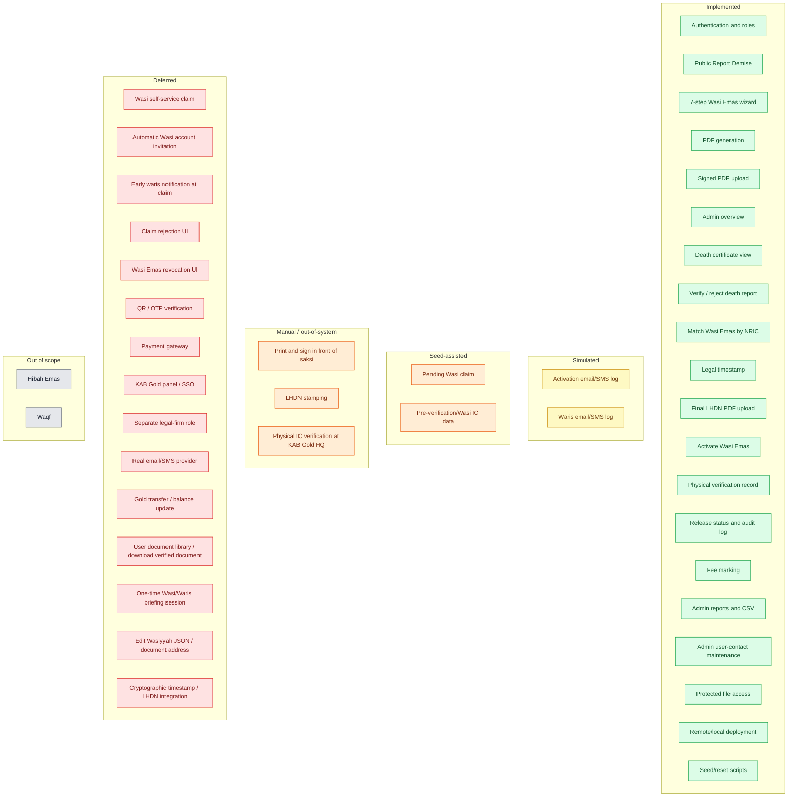

# Implementation Status and Deferred Scope

## Status Map

## Exact Status Table

| Capability | Status | What exactly exists / what is missing |
|---|---|---|
| Authentication and app roles | Implemented | Login, signup as `pewasiat`, `AuthContext`, route guards, PocketBase rules. |
| Public Report Demise | Implemented | Public form, death certificate upload, creates `Pending Verification` report. |
| Admin death certificate view | Implemented | Protected file token plus new-tab viewing. |
| Verify/reject death report | Implemented | Updates status, verification metadata, notes. Rejection does not notify anyone. |
| Match death report to Wasi Emas | Implemented | Client-side match by `deceased_nric` against `wasiemas.pewasiat_nric`; saves `wasiemas_id` and `wasi_id` on verification. |
| 7-step Wasi Emas wizard | Implemented | Pewasiat, Wasi, Aset, Waris, Tugasan, Saksi, finale. |
| PDF generation | Implemented | jsPDF document with sections and signature blocks. |
| Signed PDF upload | Implemented | Creates a `wasiemas` record with status `Pending Verification`. |
| Wasi email capture | Implemented | Step 2 now captures Wasi email for PDFs and activation logs. |
| Legal queue | Implemented | Admin/legal page lists `Pending Verification` and `Processing LHDN` records. |
| Legal timestamp | Partially implemented | Status changes to `Processing LHDN`; there is no dedicated cryptographic timestamp field. The record's `updated` autodate is the only time record. |
| Final LHDN PDF upload | Implemented | Real file input; stores `final_lhdn_pdf`; status becomes `Active`. |
| Activation notification | Simulated | Writes entries to `wasiemas.notification_log`; no real email/SMS provider. |
| Wasi account creation/invite | Deferred | Wasi accounts are seeded. The wizard captures an email but does not create or invite an account. |
| Wasi self-service claim | Deferred / seed-assisted | The demo claim is seeded. `WasiClaimAssets` cannot find eligible reports because `demise_reports` is admin-only. |
| Wasi IC pre-verification | Seed-assisted | Schema field and seeded file exist; the public form/claim UI does not upload a Wasi IC as part of a working Wasi flow. |
| Physical IC verification | Implemented as a record | Admin enters a prompt/notes and confirms; no scanner, upload, or separate evidence file. |
| Claim release | Implemented as a record | Status becomes `Approved & Released`; physical fields, audit log, and notification log are written. |
| Actual gold transfer | Deferred | No gold ledger or balance update. "Release" is an administrative record only. |
| Waris notification on release | Simulated | Notification entries are built from `wasiyyah_data.waris_list`; no real email/SMS. |
| Early waris notification at claim | Deferred | Only release notification is implemented. |
| Waris notification on activation | Deferred | Activation notification goes to Pewasiat and Wasi, not Waris. This matches the 20 Oct decision. |
| Admin overview | Implemented | KPI counts for death reports, legal queue, active Wasi Emas, claims, fees, users. |
| Admin reports/CSV | Implemented | Status counts, monthly activation table, CSV export. |
| Fee marking/report | Implemented | `fee_deducted` flag, `fee_amount`, fee list, mark deducted, report link. No actual deduction from gold. |
| KAB Gold panel/SSO | Deferred | No KAB Gold login or panel. Monthly report/CSV is the current interface. |
| Admin maintenance | Partially implemented | Search users by name/NRIC/email; edit full name, email, phone, address. Editing `wasiyyah_data` JSON/document address is deferred. |
| Claim rejection | Deferred | `Rejected` exists in the status enum, but there is no claim rejection UI/action. |
| Wasi Emas revocation | Deferred | `Revoked` exists in the status enum, but no UI action triggers it. |
| QR/OTP | Deferred | No QR generation/scanning and no OTP. The 20 Oct discussion leaned toward email. |
| Payment gateway | Deferred | No gateway. Fee is report/mark only. |
| Separate legal-firm role | Deferred | Legal verification is an admin submodule. |
| One-time briefing session | Deferred | No scheduling/session feature. |
| User document library | Deferred | No Pewasiat-facing page to view/download the verified document. |
| Real email/SMS provider | Deferred | `emailService` only logs and returns notification entries. |
| Hibah Emas / Waqf | Out of scope | Removed from the current Step 1 UI; only Wasi Emas is active. |

## What "Deferred" Means Precisely

Deferred means **there is no working end-to-end path in the current app**. It does not mean the idea is rejected forever. Depending on the item, it may have:

- a status/field in the schema but no UI action (`Rejected`, `Revoked`),
- a UI element that is not connected to a full flow (`WasiClaimAssets`),
- a manual substitute (LHDN upload, physical IC prompt),
- no implementation at all (QR, payment gateway, KAB Gold panel).

For a demo, do not present deferred items as working features. Present them as the roadmap after the admin scope.

## Demo-Safe Claims

You can safely say:

- The Pewasiat can create and upload a signed Wasi Emas.
- The legal/admin submodule can timestamp, upload the final LHDN-stamped PDF, and activate the record.
- The public can report a death with a certificate.
- The admin can view the certificate, match it to a Wasi Emas, and verify/reject.
- The admin can physically verify and release a seeded Wasi claim, with audit and notification logs.
- The admin can mark fees, export a report, and maintain user contact details.
- Files are protected and roles are enforced by PocketBase rules.

Do not say:

- Real emails or SMS are sent.
- LHDN is integrated.
- Gold is actually moved or deducted.
- The Wasi submits the claim through the current UI.
- QR/OTP, payment gateway, or KAB Gold panel exists.
- There is a separate legal-firm login.
- Claim rejection or Wasi Emas revocation is operational.
- Hibah/Waqf is part of the current scope.
